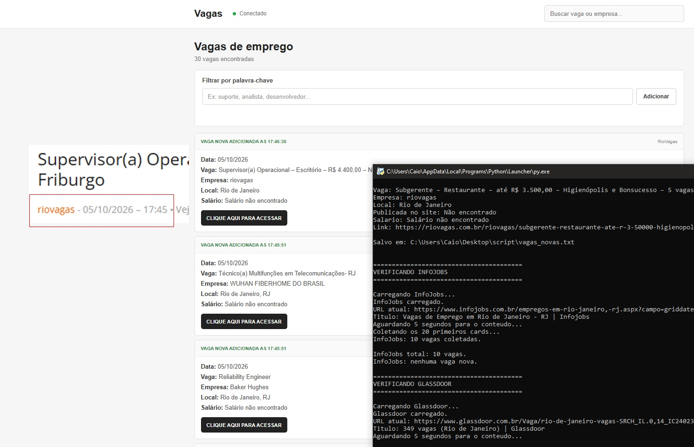

# Vagas de forma automática

Projeto desenvolvido para me ajudar a encontrar vagas recentes de forma automatizada, sem precisar que algum humano adicione manualmente.
A maior parte da lógica se encontra no script em python, onde ele envia as últimas vagas publicadas pelos sites Indeed, Glassdoor, LinkedIn, RioVagas e InfoJobs em formato de json para a API em tempo real.
O projeto está focado para a minha cidade do Rio de Janeiro, porém você pode estar alterando para a sua cidade local.

